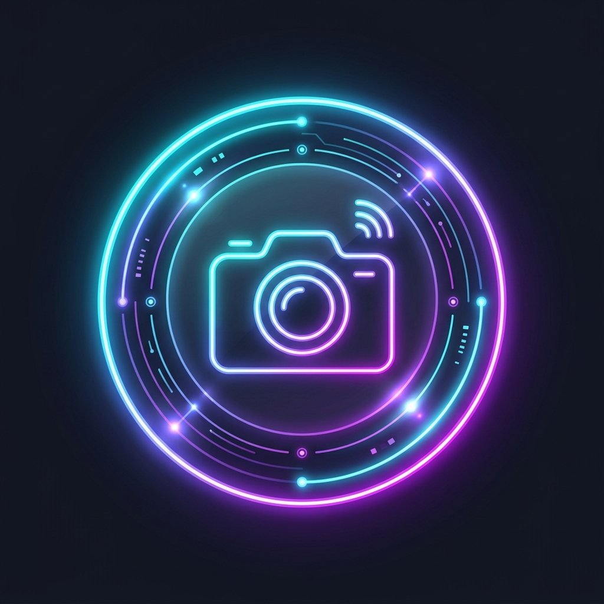

# 📱 Screen Capture Overlay (Gemini Live Floating Widget)

<p align="center">
  
</p>

<p align="center">
  <b>Android üzerinde Gemini Live benzeri her zaman üstte duran yüzen simge ile anlık ekran görüntüsü ve video kaydı alan açık kaynaklı araç.</b>
</p>

<p align="center">
  <a href="https://github.com/musabuzman13/screen-capture-overlay/releases/latest/download/ScreenCaptureOverlay-debug.apk">
    
  </a>
</p>

<p align="center">
  <a href="https://github.com/musabuzman13/screen-capture-overlay/releases">
    
  </a>
  <a href="https://github.com/musabuzman13/screen-capture-overlay/actions/workflows/build-apk.yml">
    
  </a>
  
  
</p>

---

## ⚡ Hızlı APK İndirme Bağlantıları

Telefona doğrudan yüklemek için aşağıdaki bağlantıları kullanabilirsiniz:

| Buton | Açıklama | Bağlantı |
| :--- | :--- | :--- |
| 🚀 **Tek Tıkla APK İndir** | En son derlenen `.apk` dosyasını doğrudan cihazınıza indirir | [**ScreenCaptureOverlay-debug.apk İndir**](https://github.com/musabuzman13/screen-capture-overlay/releases/latest/download/ScreenCaptureOverlay-debug.apk) |
| 📦 **Tüm Sürümler (Releases)** | Geçmiş sürümleri ve changelog notlarını görüntüler | [**Releases Sayfasına Git**](https://github.com/musabuzman13/screen-capture-overlay/releases) |
| ⚙️ **Canlı CI/CD Derleme** | GitHub Actions üzerinde çalışan APK derleme adımlarını izler | [**GitHub Actions İş Akışı**](https://github.com/musabuzman13/screen-capture-overlay/actions/workflows/build-apk.yml) |

---

## 🌟 Öne Çıkan Özellikler

- **🔮 Gemini Live Tarzı Yüzen Simge:** Ekranın üzerinde duran, parmakla serbestçe sürüklenebilen ve bırakıldığında en yakın kenara yumuşakça yapışan (snap-to-edge) ışıltılı neon buton.
- **🛡️ Gizli / Doğrudan Bellek Katmanı Yakalama:** Standart sistem ekran görüntüsü tetikleyicilerini (`Activity.ScreenCaptureCallback`, `onScreenCapture`) **çalıştırmaz**. Doğrudan Android Grafik Katmanı (SurfaceFlinger) tamponundan `VirtualDisplay` ve `ImageReader` (`PixelFormat.RGBA_8888`) bellek tamponunu okuyarak pikselleri yakalar.
- **📐 Piksel ve Satır Hizalaması (Row Stride Alignment):** Donanım bellek hizalama farklarını (`rowStride - pixelStride * width`) otomatik olarak düzelterek sıfır bozulma ile saf Bitmap oluşturur.
- **🎥 Kesintisiz Ekran Video Kaydı:** Tek tıkla `VirtualDisplay` akışını `MediaRecorder` H264 MP4 kodlayıcısına yönlendirir; isteğe bağlı mikrofon sesiyle tam ekran video kaydı alır.
- **📂 Yerel Galeri & Önizleme:** Çekilen ekran görüntüleri ve videolar otomatik olarak cihazın `Pictures/ScreenCaptures` ve `Movies/ScreenRecordings` galerisine eklenir. Jetpack Compose galerisi üzerinden anında önizlenebilir, paylaşılabilir ve silinebilir.

---

## 🚀 Kurulum ve İlk Kullanım Adımları

1. **APK'yı İndirin:** Yukarıdaki **[Doğrudan APK İndir]** bağlantısına tıklayın.
2. **Yükleyin:** İndirilen `ScreenCaptureOverlay-debug.apk` dosyasına tıklayın (Gerekirse *"Bilinmeyen kaynaklardan uygulama yüklemeye izin ver"* seçeneğini onaylayın).
3. **İzinleri Verin:**
   - **Yüzen Simge İzni (`SYSTEM_ALERT_WINDOW`):** Diğer uygulamaların üzerinde görüntülenebilmesi için.
   - **Ekran Yakalama İzni (`MediaProjection`):** Sanal ekran oluşturabilmesi için sistem ekran paylaşım onayını verin.
   - **Bildirim İzni:** Servisin arka planda Android tarafından sonlandırılmaması için.
4. **Kullanmaya Başlayın:** *"Yüzen Simgeyi Ekrana Getir"* butonuna basın. Artık herhangi bir uygulamadayken yüzen simgeye dokunarak anlık ekran görüntüsü alabilir veya video kaydı başlatabilirsiniz!

---

## 🏗️ Mimari ve Çalışma Mantığı

```text
[ Fiziksel Ekran / SurfaceFlinger ]
                 │
                 ▼
[ MediaProjection API (Foreground Service) ]
                 │
                 ▼
[ VirtualDisplay (VIRTUAL_DISPLAY_FLAG_AUTO_MIRROR) ]
                 │
       ┌─────────┴─────────────────────┐
       ▼                               ▼
[ ImageReader Tamponu ]      [ MediaRecorder Surface ]
  - PixelFormat.RGBA_8888      - H264 Video Encoder
  - Row Stride Hesaplaması     - AAC Mikrofon Sesi
  - Sıfır Sistem Tetikleyicisi - MP4 Video Çıktısı
       │                               │
       ▼                               ▼
[ Pictures/ScreenCaptures ]   [ Movies/ScreenRecordings ]
```

---

## 🛠️ GitHub Actions CI/CD ile Otomatik Derleme

Bu depoda `.github/workflows/build-apk.yml` dosyası hazır olarak bulunur:
- `main` dalına her `git push` yaptığınızda GitHub sunucuları otomatik olarak APK'yı derler.
- Derlenen APK **Releases** sekmesinde son sürüm olarak yayımlanır.

### Kendi Deponuza Gönderme Komutları:
```bash
git add .
git commit -m "Screen Capture Overlay hazır"
git push origin main
```
Push ettikten sonra deponuzun **Actions** sekmesinden derleme durumunu izleyebilirsiniz!
